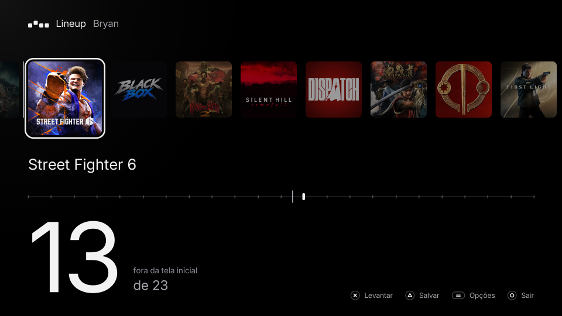
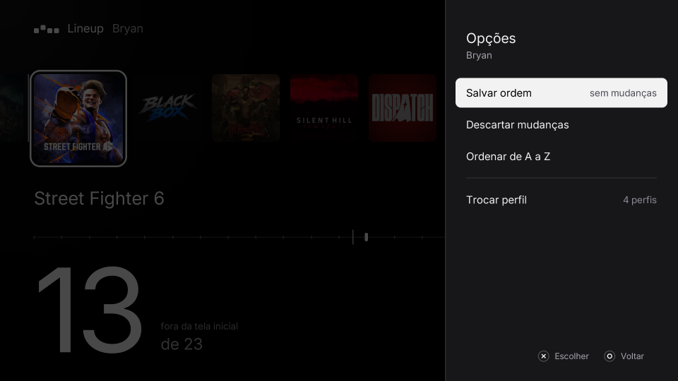

# Lineup

Reorder the game row on your PS5 home screen with the controller. Lift a game, carry it, drop it,
save.

[Português](README.pt-BR.md)

Lineup is a homebrew app for jailbroken PS5 consoles. The system orders the home row by when you last
opened each game, and it offers no way to arrange it yourself. Lineup reads the row and lets you lay it
out on the TV. Its local service then writes the new order where the home screen keeps it.

## Features

- **Lift, move, drop.** ✕ lifts the focused game, the D-pad carries it and ✕ drops it. ◯ while carrying
  puts it back.
- **Every profile.** Each console profile has its own row, shown with its picture. Switch from the
  Options menu.
- **Home screen edge.** The home screen shows only the first 12 games. A divider in the row and a mark
  on the ruler show where that edge falls, and games past it read "not on the home screen".
- **Pinned games.** □ pins the focused game where it stands when you save. Opening other games no longer
  pushes it out of its place; the rest of the row still follows the system's rule. Options can pin the
  whole row, unpin all, or remove pinned games from every profile. Works from 1.3.0 on.
- **Sort A to Z**, discard changes, and a count of the games that changed.
- **Applies on exit.** Saving closes the app, and the home screen comes back with the new order. No
  restart needed.
- **Updates in the app.** Lineup checks for a new release once a day (Options → Updates turns that off),
  downloads it when you choose **Update**, and opens again on the new version. Options → Updates can
  also go back to the previous version. This works from 1.2.0 on.
- **English and Brazilian Portuguese**, chosen from the console's system language.

## Requirements

- A PS5 running a jailbreak with **kstuff** and an **ELF loader on port 9021** (elfldr, or etaHEN's).
  Lineup sends its service to that loader when it opens.
- **ShadowMountPlus**, to register the app on the home screen.

Tested on firmware **13.60** with kstuff, elfldr 0.26 and ShadowMountPlus. Other firmware versions are
untested.

## Install

Download the files from the [latest release](https://github.com/bps2414/lineup/releases/latest).

- **exFAT image (easiest).** Copy `Lineup-<version>.exfat` into `/data/homebrew/` over FTP, or into a
  `homebrew/` folder on an exFAT USB drive. ShadowMountPlus mounts it and adds Lineup to the home screen
  within a few seconds.
- **Folder.** Unzip `Lineup-<version>.zip` and upload its `PPSA99077/` folder to
  `/data/homebrew/PPSA99077` over FTP.

Use one or the other. Both register title ID `PPSA99077`.

## Use

| Button | On the row | While carrying |
| --- | --- | --- |
| ✕ | Lift the focused game | Drop it here |
| D-pad | Move focus | Carry the game |
| □ | Pin or unpin the focused game | Pin or unpin it |
| △ | Save | |
| Options | Options menu | |
| ◯ | Quit (asks to save unsaved changes) | Put the game back |

Opening a game afterwards still moves it to the front, as it always does, unless a pinned game holds
that place.

## Safety

- Writes go through the **lineupd** service only, in one SQLite transaction. The new order reuses the
  index values the row already holds, so no value grows past what the system expects.
- Before each save, lineupd copies the database to `/data/lineup/backups/` (the 5 newest are kept) and
  runs SQLite's `quick_check` first. It runs `integrity_check` after the write.
- If the row changed since Lineup read it (you opened a game meanwhile), the save is refused and the
  row reloads.

## How it works

The app is written in React and runs natively on the console through
[PS5 React](#ps5-react). A small C service, `lineupd`, ships inside the app folder. The app starts it
through the ELF loader, and it answers on `127.0.0.1:9077`. It reads the per-profile tables in
`/system_data/priv/mms/app.db` and writes the new order back. Pinned games are kept in place by SQLite
triggers it adds to that database; `POST /pins/off` and `POST /pins/uninstall` take them out again.

See [docs/ARCHITECTURE.md](docs/ARCHITECTURE.md) for the components, the service's HTTP API and what
was learned about how the home screen stores its row.

## PS5 React

[PS5 React](https://github.com/half144/ps5-react), by half144, is a framework for standalone,
fullscreen PS5 homebrew written in React and JSX. It runs the app through QuickJS and Embedded React,
draws the interface in software and presents it with OpenGL, and gives the app controller input,
focus navigation, animation, a subset of Tailwind classes, HTTP and filesystem access. It also has a
native macOS preview, and builds a PS5 application folder from the same code.

The framework lives in [`ps5-react/`](ps5-react) in this repository, with one addition Lineup needs:
`Payloads.start(name)` plus a build step. The build step compiles an app's own `payloads/*.c` into
ELFs, and `Payloads.start` sends one of them to the console's ELF loader. Everything else is as
published.

## Building

Linux or WSL: `scripts/test.sh`, `scripts/build.sh`, `scripts/package.sh <version>`. See
[docs/BUILDING.md](docs/BUILDING.md). CI builds every push, and tags `vX.Y.Z` publish a release with the
exFAT image, the zip and the full source.

## Credits

PS5 React — created by half144 and PS5 React contributors.
https://github.com/half144/ps5-react

The framework's own dependencies keep their licenses and notices: see
[ps5-react/NOTICE](ps5-react/NOTICE) and the `notices/` folder in every build. Lineup's interface uses
the Inter typeface (SIL Open Font License) and sounds derived from Google's Material Design sound
resources (CC BY 4.0).

## License

GPL-3.0-or-later, with the PS5 React attribution term in
[ps5-react/LICENSE-ATTRIBUTION](ps5-react/LICENSE-ATTRIBUTION). See [LICENSE](LICENSE).

Lineup is not affiliated with or endorsed by Sony Interactive Entertainment. "PlayStation" and "PS5"
are trademarks of their owners. Use at your own risk.
