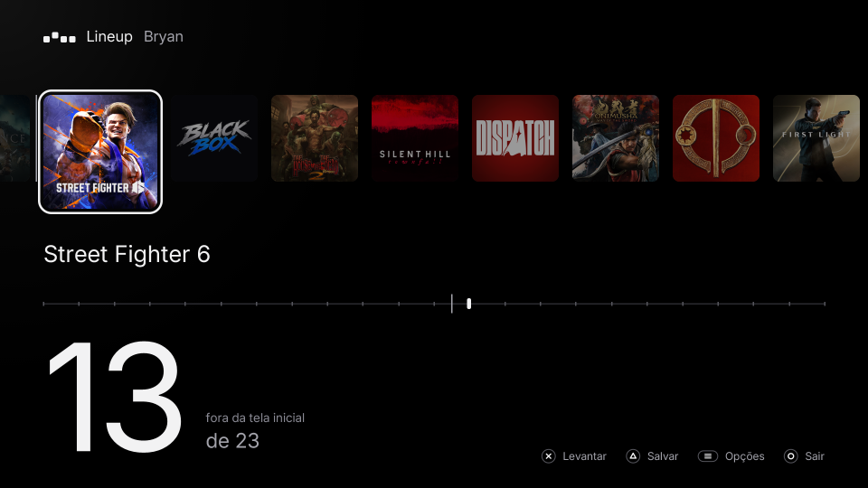
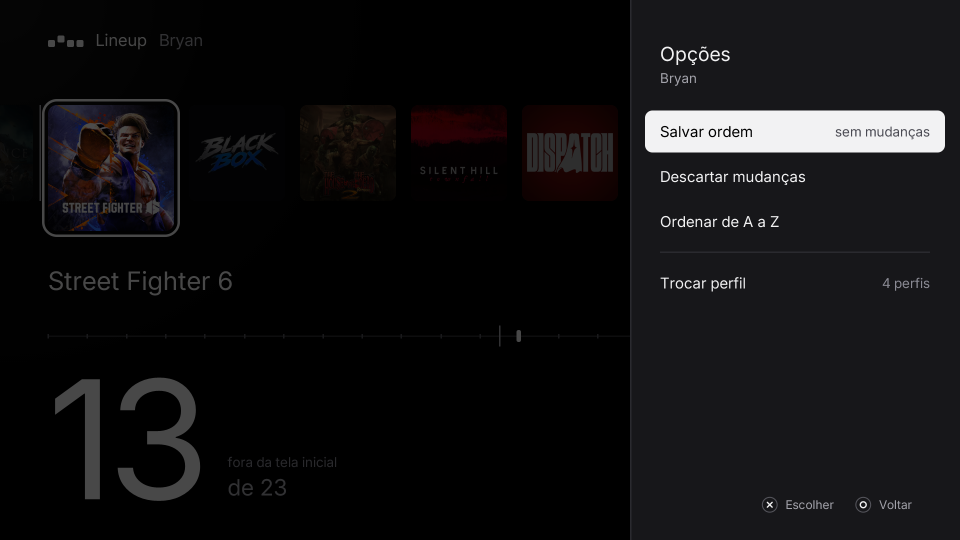

  

<h1 align="center">Lineup</h1>

<strong>Arrange your PS5 home screen with the controller.</strong> Lift a game, carry it, drop it. Pin the ones that should never move.

  <a href="https://github.com/bps2414/lineup/releases/latest"><strong>Download</strong></a> ·
  <a href="#how-it-works">How it works</a> ·
  <a href="#faq">FAQ</a> ·
  <a href="CHANGELOG.md">Changelog</a> ·
  <a href="README.pt-BR.md">Português</a>

  
  
  
  

## Why Lineup

- **The console decides your row.** The PS5 orders the home row by when you last opened each game, and it offers no way to arrange it yourself.
- **On the TV, with the controller.** No PC, no editing databases over FTP. You see the row as it is and move games where you want them.
- **Pins that hold.** A pinned game keeps its place when you open other games.
- **Safe by default.** Every save backs up the home screen's database first and checks it before and after writing.

## How it works

1. **Open** Lineup from the home screen. It reads the row of the current profile.
2. **Lift** a game with ✕, **carry** it with the D-pad and drop it with ✕.
3. **Pin** with □ the games that should stay where they are.
4. **Save** with △. Lineup closes, and the home screen comes back with the new order. No restart needed.

Opening a game afterwards still moves it to the front, as it always does, unless a pinned game holds that place.

## Features

**Arrange it your way**
- Lift, move, drop. ◯ while carrying puts the game back.
- Sort A to Z, discard changes, and a count of the games that changed.
- Every console profile has its own row, shown with its picture. Switch from the Options menu.
- L1 and R1 switch between the Games and Media tabs. Media apps move and pin like games, each tab with its own pins.

**See where the edge is**
- The home screen shows only the first 12 games. A divider in the row and a mark on the ruler show where that edge falls, and games past it read "not on the home screen".

**Keep it that way**
- □ pins the focused game where it stands when you save. The rest of the row still follows the system's rule.
- Options → Arrange the row pins the whole row or unpins all; Options → More options removes pins from every profile.

**Tidy the tabs**
- Focus an app and press Options: Move and Hide are at the top.
- Homebrew and emulators move between Games and Media on every profile.
- Any app on those tabs, and the PS Store, can be hidden on the current profile. It stays hidden across restarts and comes back from Options → Hidden apps.

**Stays up to date**
- Lineup checks for a new release when it opens and shows its notes, downloads it when you choose **Update**, and opens again on the new version. Options → More options → Updates turns the check off or goes back to the previous version.
- English and Brazilian Portuguese, chosen from the console's system language.

## Install

You need a PS5 running a jailbreak with **kstuff**, an **ELF loader on port 9021** (elfldr, or etaHEN's) and **ShadowMountPlus**. Lineup sends its service to that loader when it opens.

1. Download `Lineup-<version>.exfat` from the [latest release](https://github.com/bps2414/lineup/releases/latest).
2. Copy it into `/data/homebrew/` over FTP, or into a `homebrew/` folder on an exFAT USB drive.
3. Wait a few seconds: ShadowMountPlus mounts it and adds Lineup to the home screen.

Prefer a folder? Unzip `Lineup-<version>.zip` and upload its `PPSA99077/` folder to `/data/homebrew/PPSA99077` instead. Use one or the other: both register title ID `PPSA99077`.

Tested on a console on firmware **13.60** with kstuff, elfldr 0.26 and ShadowMountPlus. The home screen database of **11.40** and **13.00** has the same layout, and Lineup's self-test (order, pins, moving and hiding) passes on copies of it; firmware older than 11.00 has not been checked. Lineup runs wherever ShadowMountPlus and an ELF loader on port 9021 do.

## Controls

| Button | On the row | While carrying |
| --- | --- | --- |
| ✕ | Lift the focused game | Drop it here |
| D-pad | Move focus | Carry the game |
| □ | Pin or unpin the focused game | Pin or unpin it |
| △ | Save | |
| L1 / R1 | Games tab / Media tab | |
| Options | Options menu | |
| ◯ | Quit (asks to save unsaved changes) | Put the game back |

## Safety

- Writes go through the **lineupd** service only, in one SQLite transaction. The new order reuses the index values the row already holds, so no value grows past what the system expects.
- Before each save, lineupd copies the database to `/data/lineup/backups/` (the 10 newest are kept, plus the databases as they were the first time 2.0.0 ran) and runs SQLite's `quick_check` first. It runs `integrity_check` after the write.
- If the row changed since Lineup read it (you opened a game meanwhile), the save is refused and the row reloads.

## FAQ

**A game I opened jumped back to the front.**
That is the system's rule, and Lineup keeps it. Pin the game with □ and save: it holds its place from then on.

**Does the order survive a restart?**
Yes. Lineup writes it where the home screen keeps the row, and hidden apps stay hidden too.

**Does it work on my firmware?**
It is tested on a 13.60 console, and its database checks pass on copies from 11.40 and 13.00. On another version, [report whether it worked](https://github.com/bps2414/lineup/issues/new?template=firmware.yml); on firmware older than 11.00, attach Options → More options → Save a bug report, since the database there may differ.

**How do I go back to the system's order?**
Options → More options → Remove pins from every profile. Every profile goes back to "last opened comes first", and hidden apps come back.

**Something went wrong.**
Options → More options → Save a bug report, then attach the file to an [issue](https://github.com/bps2414/lineup/issues). It lists the apps and how the home screen stores them, with no names or passwords.

## Under the hood

The app is written in React and runs natively on the console through [PS5 React](#ps5-react). A small C service, `lineupd`, ships inside the app folder. The app starts it through the ELF loader, and it answers on `127.0.0.1:9077`. It reads the per-profile tables in `/system_data/priv/mms/app.db` and writes the new order back. Pinned games are kept in place by SQLite triggers it adds to that database; `POST /pins/off` and `POST /pins/uninstall` take them out again.

See [docs/ARCHITECTURE.md](docs/ARCHITECTURE.md) for the components, the service's HTTP API and what was learned about how the home screen stores its row.

### PS5 React

[PS5 React](https://github.com/half144/ps5-react), by half144, is a framework for standalone, fullscreen PS5 homebrew written in React and JSX. It runs the app through QuickJS and Embedded React, draws the interface in software and presents it with OpenGL, and gives the app controller input, focus navigation, animation, a subset of Tailwind classes, HTTP and filesystem access. It also has a native macOS preview, and builds a PS5 application folder from the same code.

The framework lives in [`ps5-react/`](ps5-react) in this repository, with one addition Lineup needs: `Payloads.start(name)` plus a build step. The build step compiles an app's own `payloads/*.c` into ELFs, and `Payloads.start` sends one of them to the console's ELF loader. Everything else is as published.

### Building

Linux or WSL: `scripts/test.sh`, `scripts/build.sh`, `scripts/package.sh <version>`. See [docs/BUILDING.md](docs/BUILDING.md). CI builds every push, and tags `vX.Y.Z` publish a release with the exFAT image, the zip and the full source.

## Credits

PS5 React — created by half144 and PS5 React contributors.
https://github.com/half144/ps5-react

The framework's own dependencies keep their licenses and notices: see [ps5-react/NOTICE](ps5-react/NOTICE) and the `notices/` folder in every build. Lineup's interface uses the Inter typeface (SIL Open Font License) and sounds derived from Google's Material Design sound resources (CC BY 4.0).

## License and disclaimer

GPL-3.0-or-later, with the PS5 React attribution term in [ps5-react/LICENSE-ATTRIBUTION](ps5-react/LICENSE-ATTRIBUTION). See [LICENSE](LICENSE).

Lineup is homebrew for consoles you own. It only changes the order and visibility of apps already installed on your console, and it does not include, download or unlock any game, firmware or key. It is an independent project, not affiliated with or endorsed by Sony Interactive Entertainment. "PlayStation" and "PS5" are trademarks of their owners. Use at your own risk.

---

  

If Lineup tidied your home screen, a ★ on the repo helps other people find it.

