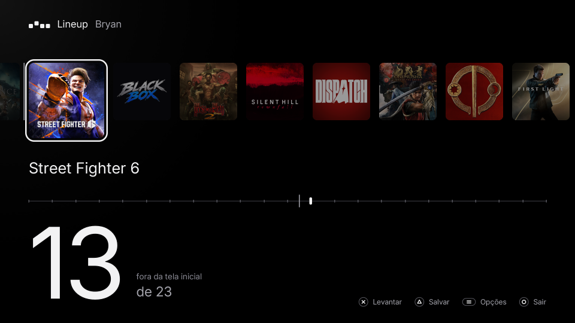
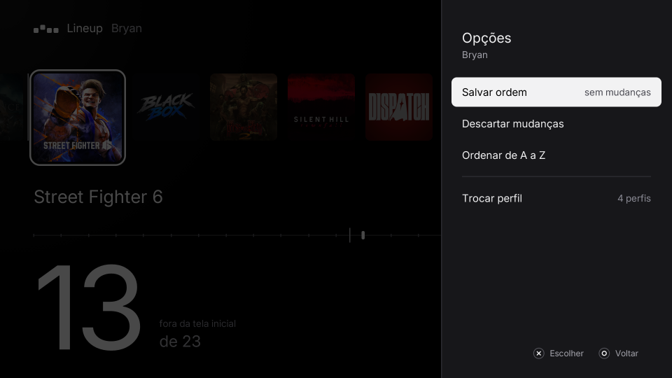

  

<h1 align="center">Lineup</h1>

<strong>Arrume a tela inicial do PS5 pelo controle.</strong> Levante um jogo, leve, solte. Fixe os que nunca devem sair do lugar.

  <a href="https://github.com/bps2414/lineup/releases/latest"><strong>Baixar</strong></a> ·
  <a href="#como-funciona">Como funciona</a> ·
  <a href="#perguntas-frequentes">Perguntas</a> ·
  <a href="docs/pt-BR/NOVIDADES.md">Novidades</a> ·
  <a href="README.md">English</a>

  
  
  
  

## Por que o Lineup

- **Quem decide a fileira é o console.** O PS5 ordena a fileira pela última vez que você abriu cada jogo e não deixa você arrumar do seu jeito.
- **Na TV, pelo controle.** Sem PC e sem editar banco de dados por FTP. Você vê a fileira como ela é e põe cada jogo onde quiser.
- **Fixos que ficam.** Um jogo fixo mantém o lugar quando você abre outros jogos.
- **Seguro por padrão.** Cada gravação faz backup do banco da tela inicial antes e confere o banco antes e depois de gravar.

## Como funciona

1. **Abra** o Lineup pela tela inicial. Ele lê a fileira do perfil atual.
2. **Levante** um jogo com ✕, **leve** com o direcional e solte com ✕.
3. **Fixe** com □ os jogos que devem ficar onde estão.
4. **Salve** com △. O Lineup fecha, e a tela inicial volta com a nova ordem. Não precisa reiniciar.

Abrir um jogo depois continua trazendo ele para a frente, como sempre, a não ser que um jogo fixo ocupe esse lugar.

## Recursos

**Arrume do seu jeito**
- Levantar, mover, soltar. ◯ durante o movimento devolve o jogo ao lugar.
- Ordenar de A a Z, descartar mudanças e contagem de jogos que mudaram.
- Cada perfil do console tem sua fileira, mostrada com a foto dele. Troque pelo menu Opções.
- L1 e R1 trocam entre as abas Jogos e Mídia. Os apps da Mídia se movem e fixam como os jogos, cada aba com os seus fixos.

**Veja onde fica o limite**
- A tela inicial mostra só os 12 primeiros jogos. Um traço na fileira e uma marca na régua mostram onde fica esse limite, e os jogos depois dele aparecem como "fora da tela inicial".

**Mantenha assim**
- □ fixa o jogo em foco na posição em que ele estiver ao salvar. O resto da fileira segue a regra do sistema.
- Opções → Organizar a fileira fixa a fileira toda ou desafixa todos; Opções → Mais opções remove os fixos de todos os perfis.

**Arrume as abas**
- Deixe o foco no app e aperte Opções: Mover e Esconder ficam no topo.
- Homebrew e emuladores mudam entre Jogos e Mídia em todos os perfis.
- Qualquer app dessas abas, e a PS Store, pode ser escondido no perfil atual. Continua escondido depois de reiniciar e volta em Opções → Apps escondidos.

**Sempre atualizado**
- O Lineup procura uma versão nova ao abrir e mostra as novidades, baixa quando você escolhe **Atualizar** e abre de novo na versão nova. Em Opções → Mais opções → Atualizações dá para desligar a procura ou voltar à versão anterior.
- Inglês e português do Brasil, escolhidos pelo idioma do sistema.

## Instalação

Você precisa de um PS5 com jailbreak, **kstuff**, um **ELF loader na porta 9021** (elfldr, ou o do etaHEN) e o **ShadowMountPlus**. O Lineup envia o serviço dele para esse loader quando abre.

1. Baixe `Lineup-<versão>.exfat` da [release mais recente](https://github.com/bps2414/lineup/releases/latest).
2. Copie para `/data/homebrew/` por FTP, ou para uma pasta `homebrew/` num pendrive exFAT.
3. Espere alguns segundos: o ShadowMountPlus monta a imagem e põe o Lineup na tela inicial.

Prefere pasta? Descompacte `Lineup-<versão>.zip` e envie a pasta `PPSA99077/` para `/data/homebrew/PPSA99077`. Use um ou outro: os dois registram o title ID `PPSA99077`.

Testado no firmware **13.60** com kstuff, elfldr 0.26 e ShadowMountPlus. Os outros firmwares não foram testados.

## Controles

| Botão | Na fileira | Levando um jogo |
| --- | --- | --- |
| ✕ | Levanta o jogo em foco | Solta aqui |
| Direcional | Move o foco | Leva o jogo |
| □ | Fixa ou desafixa o jogo em foco | Fixa ou desafixa o jogo |
| △ | Salva | |
| L1 / R1 | Aba Jogos / aba Mídia | |
| Options | Menu Opções | |
| ◯ | Sai (pergunta se quer salvar as mudanças) | Devolve o jogo |

## Segurança

- A gravação passa só pelo serviço **lineupd**, numa única transação SQLite. A nova ordem reaproveita os índices que a fileira já tem, então nenhum valor passa do que o sistema espera.
- Antes de salvar, o lineupd copia o banco para `/data/lineup/backups/` (guarda os 5 mais recentes) e roda o `quick_check` do SQLite. Depois da gravação, roda o `integrity_check`.
- Se a fileira mudou desde a leitura (você abriu um jogo nesse meio-tempo), a gravação é recusada e a fileira é carregada de novo.

## Perguntas frequentes

**Um jogo que eu abri voltou para a frente.**
É a regra do sistema, e o Lineup mantém. Fixe o jogo com □ e salve: a partir daí ele segura o lugar.

**A ordem sobrevive a reiniciar o console?**
Sim. O Lineup grava onde a tela inicial guarda a fileira, e os apps escondidos continuam escondidos.

**Funciona no meu firmware?**
Foi testado no 13.60. Se você testar em outra versão, abra uma [issue](https://github.com/bps2414/lineup/issues) contando se funcionou.

**Como volto para a ordem do sistema?**
Opções → Mais opções → Remover fixos de todos os perfis. Todos os perfis voltam a "o último aberto vai para a frente", e os apps escondidos voltam.

**Deu algo errado.**
Opções → Mais opções → Salvar relatório de bug, e anexe o arquivo numa [issue](https://github.com/bps2414/lineup/issues). Ele lista os apps e como a tela inicial guarda cada um, sem nomes nem senhas.

## Por dentro

O app é escrito em React e roda nativo no console pelo [PS5 React](#ps5-react). Um pequeno serviço em C, o `lineupd`, vai dentro da pasta do app. O app inicia o serviço pelo ELF loader, e ele responde em `127.0.0.1:9077`. Ele lê as tabelas de cada perfil em `/system_data/priv/mms/app.db` e grava a nova ordem. Os jogos fixos ficam no lugar graças a triggers do SQLite que ele cria nesse banco; `POST /pins/off` e `POST /pins/uninstall` tiram tudo de novo.

Veja [docs/pt-BR/ARQUITETURA.md](docs/pt-BR/ARQUITETURA.md) para os componentes, a API HTTP do serviço e o que se descobriu sobre como a tela inicial guarda a fileira.

### PS5 React

O [PS5 React](https://github.com/half144/ps5-react), do half144, é um framework para homebrew de PS5 em tela cheia escrito em React e JSX. Ele roda o app com QuickJS e Embedded React, desenha a interface em software e apresenta com OpenGL, e dá ao app controle, navegação por foco, animação, um subconjunto do Tailwind, HTTP e acesso a arquivos. Também tem um preview nativo no macOS e gera a pasta do app para PS5 a partir do mesmo código.

O framework fica em [`ps5-react/`](ps5-react) neste repositório, com um acréscimo que o Lineup precisa: `Payloads.start(nome)` mais uma etapa no build. A etapa compila os `payloads/*.c` do app em ELFs, e o `Payloads.start` envia um deles ao ELF loader do console. O resto está como foi publicado.

### Compilar

Linux ou WSL: `scripts/test.sh`, `scripts/build.sh`, `scripts/package.sh <versão>`. Veja [docs/pt-BR/COMPILAR.md](docs/pt-BR/COMPILAR.md). O CI compila cada push, e tags `vX.Y.Z` publicam uma release com a imagem exFAT, o zip e o código-fonte completo.

## Créditos

PS5 React — created by half144 and PS5 React contributors.
https://github.com/half144/ps5-react

As dependências do framework mantêm suas licenças e avisos: veja [ps5-react/NOTICE](ps5-react/NOTICE) e a pasta `notices/` de cada build. A interface do Lineup usa a fonte Inter (SIL Open Font License) e sons derivados dos recursos de som do Material Design do Google (CC BY 4.0).

## Licença e aviso

GPL-3.0-or-later, com o termo de atribuição do PS5 React em [ps5-react/LICENSE-ATTRIBUTION](ps5-react/LICENSE-ATTRIBUTION). Veja [LICENSE](LICENSE).

O Lineup é homebrew para consoles que são seus. Ele só muda a ordem e a visibilidade de apps já instalados no seu console, e não inclui, baixa nem desbloqueia nenhum jogo, firmware ou chave. É um projeto independente, sem ligação com a Sony Interactive Entertainment e sem endosso dela. "PlayStation" e "PS5" são marcas de seus donos. Use por sua conta e risco.

---

  

Se o Lineup arrumou sua tela inicial, uma ★ no repo ajuda outras pessoas a encontrarem.

